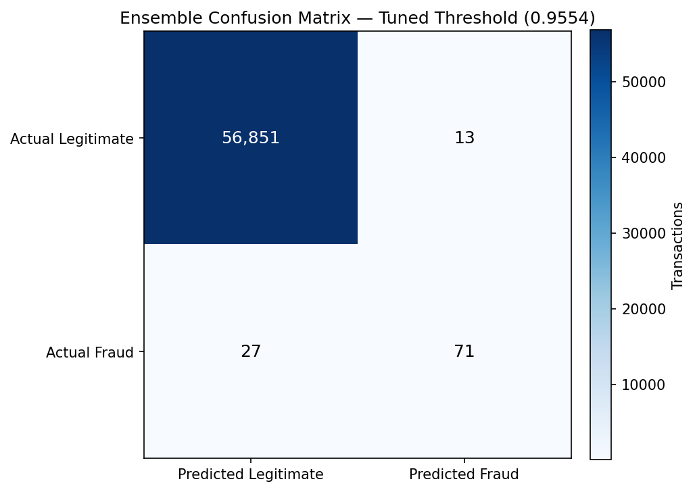
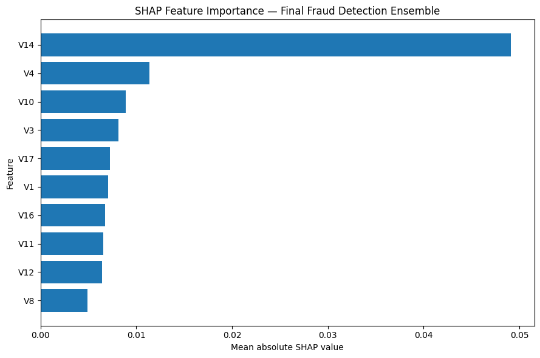
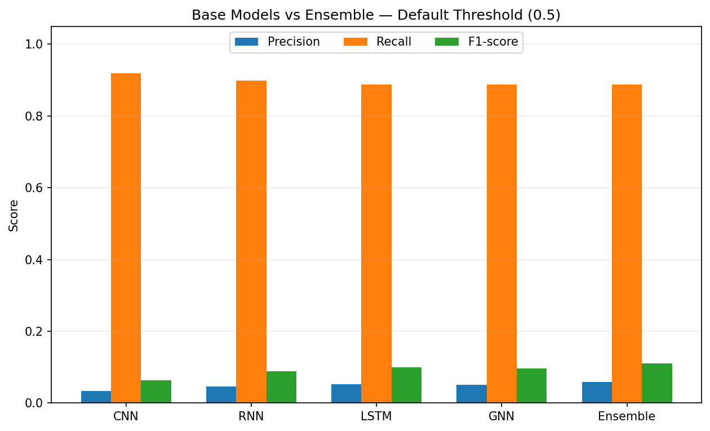

# Explainable Credit Card Fraud Detection Using a Deep Learning Ensemble

A research-inspired implementation of an explainable credit card fraud detection framework combining **CNN, RNN, LSTM, and GNN models** with weighted aggregation, confidence-aware selection, a meta-learner, and SHAP-based explanations.

The project explores how deep learning ensembles and explainable AI can help detect fraudulent transactions in highly imbalanced financial datasets.

## Project Overview

Credit card fraud detection is a challenging binary classification problem because fraudulent transactions represent only a small fraction of all transactions. A useful model must identify fraudulent activity while limiting false alarms on legitimate transactions.

This project implements a research-inspired ensemble framework using multiple neural network architectures and a confidence-aware combination mechanism. It also uses SHAP to investigate which input features influence model predictions.

**Key highlights**
- Multiple deep learning models: CNN, RNN, LSTM, and GNN.
- DOWA- and IOWA-inspired weighted aggregation.
- Confidence-aware selection between model branches.
- A multilayer perceptron (MLP) meta-learner.
- Class-imbalance handling using weighted loss.
- Validation-based decision threshold selection.
- Model evaluation using precision, recall, F1-score, ROC-AUC, and PR-AUC.
- SHAP-based feature importance analysis.

## Objectives

1. Implement a research-inspired deep learning ensemble for fraud detection.
2. Evaluate individual models and compare them with the ensemble.
3. Address class imbalance in transaction data.
4. Investigate the effect of decision threshold tuning on fraud detection.
5. Explain model predictions using SHAP.
6. Explore the trade-off between detecting fraudulent transactions and reducing false positives.

## Tech Stack

- **Language:** Python
- **Deep Learning:** PyTorch
- **Data Processing:** Pandas, NumPy
- **Machine Learning:** Scikit-learn
- **Explainable AI:** SHAP
- **Visualization:** Matplotlib, Seaborn
- **Environment:** Google Colab / Jupyter Notebook

## Dataset

This project uses the **Credit Card Fraud Detection dataset** from Kaggle.

Dataset link: https://www.kaggle.com/datasets/mlg-ulb/creditcardfraud

The dataset contains 284,807 transactions, including 492 fraudulent transactions, making it highly imbalanced.

The dataset includes anonymized transaction features (`V1`–`V28`), transaction amount, transaction time, and a binary target column named `Class`.

- `Class = 0`: Legitimate transaction
- `Class = 1`: Fraudulent transaction

### Dataset access

The dataset is not included in this repository.

To run the notebook:
1. Download `creditcard.csv` from Kaggle.
2. Open the notebook in Google Colab.
3. Run the dataset upload cell.
4. Select the downloaded CSV file when prompted.

This approach avoids committing the dataset to GitHub.

## Methodology

### 1. Data preprocessing

- Load the dataset into a Pandas DataFrame.
- Select the features used by the implementation.
- Split the data into training, validation, and test sets.
- Fit preprocessing transformations on the training set to avoid data leakage.
- Handle class imbalance using a weighted loss function.

### 2. Feature selection

The implementation uses the following ten features based on the feature ranking discussed in the reference paper:

`V14`, `V10`, `V4`, `V17`, `V12`, `V11`, `V16`, `V8`, `V3`, `V1`

### 3. Individual deep learning models

The framework includes four model architectures:

| Model | Purpose |
|---|---|
| CNN | Learns local patterns in transaction feature representations. |
| RNN | Learns sequential-style patterns in the input representation. |
| LSTM | Uses gated recurrent units to model dependencies in the input representation. |
| GNN | Learns representations using relationships between transactions in a constructed feature-space graph. |

### 4. Weighted aggregation

Two aggregation mechanisms are implemented:

- **DOWA-inspired aggregation:** Combines predictions using an ordered weighted aggregation approach.
- **IOWA-inspired aggregation:** Uses importance-weighted aggregation to combine model outputs.

These mechanisms help combine predictions from different model branches.

### 5. Confidence-aware selection

A confidence-based mechanism estimates prediction confidence and selects between the aggregated branch outputs.

The selected output, together with additional branch outputs, is passed to the meta-learner.

### 6. Meta-learner

A multilayer perceptron (MLP) combines the outputs of the base-model branches to produce the final fraud probability.

### 7. Decision threshold tuning

Instead of relying only on the default classification threshold of 0.5, the implementation selects a threshold using the validation precision–recall curve to optimize F1-score.

Threshold tuning changes the balance between precision and recall. It does not change the ROC-AUC or PR-AUC calculated from the same prediction scores.

### 8. Explainability with SHAP

SHAP is used to investigate feature contributions to model predictions.

Feature importance visualizations help interpret which input features influence the model's fraud predictions. These explanations describe the trained implementation and should not be interpreted as proof of causation.

## Results

The following results were obtained from the implementation discussed in this project. They should be reproduced from the final notebook before being treated as definitive results.

### Individual model and ensemble comparison

Metrics at the default classification threshold of 0.5:

| Model | Accuracy | Precision | Recall | F1-score | ROC-AUC | PR-AUC |
|---|---:|---:|---:|---:|---:|---:|
| CNN | 0.9540 | 0.0333 | 0.9184 | 0.0642 | 0.9796 | 0.7073 |
| RNN | 0.9682 | 0.0466 | 0.8980 | 0.0886 | 0.9771 | 0.5740 |
| LSTM | 0.9721 | 0.0523 | 0.8878 | 0.0988 | 0.9617 | 0.7033 |
| GNN | 0.9712 | 0.0506 | 0.8878 | 0.0958 | 0.9659 | 0.5235 |
| Ensemble | 0.9755 | 0.0591 | 0.8878 | 0.1108 | 0.9731 | 0.6339 |

Accuracy alone is not sufficient for evaluating fraud detection because the dataset is highly imbalanced. Precision, recall, F1-score, and PR-AUC provide additional insight into minority-class performance.

### Effect of threshold tuning

| Metric | Threshold = 0.5 | Validation-tuned threshold ≈ 0.9554 |
|---|---:|---:|
| Precision | 0.0591 | 0.8452 |
| Recall | 0.8878 | 0.7245 |
| F1-score | 0.1108 | 0.7802 |
| False positives | 1,386 | 13 |

At the validation-selected threshold, the model identified 71 of the 98 fraudulent transactions in the test set and produced 13 false positives.

The results illustrate the trade-off between detecting more fraud and reducing false alarms. The higher threshold improves precision and F1-score but reduces recall, so it also misses more fraudulent transactions.

ROC-AUC and PR-AUC remain unchanged when only the decision threshold changes, provided the underlying prediction scores are the same.

## Visualizations

The notebook contains the model evaluation and explainability visualizations.

Recommended figures to include in this repository are:

1. Confusion matrix at the selected threshold.
2. Precision–recall curve showing the threshold-selection process.
3. Model comparison chart.
4. SHAP feature-importance plot.

Once the figures have been saved into a `results/` folder, they can be embedded here using their actual filenames. For example:

```markdown





```

These image paths are examples; add them only after the corresponding files have been committed to the repository.

## How to Run

### Option 1: Google Colab

1. Open `fraud_detection_ensemble.ipynb` in this repository.
2. Download the notebook or open it in Google Colab.
3. Download the dataset from Kaggle.
4. Run the dataset upload cell and select `creditcard.csv`.
5. Execute the notebook cells in order.
6. Review the evaluation metrics, plots, threshold analysis, and SHAP explanations.

### Option 2: Local environment

Clone the repository:

```bash
git clone https://github.com/harshj0207/explainable-fraud-detection.git
cd explainable-fraud-detection
```

Create and activate a virtual environment, then install the dependencies:

```bash
python -m venv .venv
```

On Windows:

```bash
.venv\Scripts\activate
```

On macOS or Linux:

```bash
source .venv/bin/activate
```

Install dependencies:

```bash
pip install -r requirements.txt
```

Open Jupyter Notebook:

```bash
jupyter notebook
```

Open `fraud_detection_ensemble.ipynb`, obtain the dataset from Kaggle, and follow the notebook's data-loading instructions.

**Note:** PyTorch and PyTorch Geometric may require environment-specific installation steps. Google Colab is the recommended starting environment for this implementation.

## Repository Structure

```text
explainable-fraud-detection/
│
├── fraud_detection_ensemble.ipynb
├── README.md
├── requirements.txt
└── results/
    ├── confusion_matrix.png
    ├── model_comparison.png
    └── shap_feature_importance.png
```

The `results/` directory is optional until you save and upload the figures. The dataset itself should remain outside the repository.

## Limitations

- This is a research-inspired implementation, not a verified exact reproduction of every detail in the reference paper.
- The graph used by the GNN is constructed using nearest neighbors in feature space; it is not a real-world transaction network.
- The implemented aggregation mechanisms may simplify the formulations and training objectives described in the paper.
- The meta-learner's training procedure should be reviewed for stacking leakage. Training it on out-of-fold base-model predictions would provide a more rigorous evaluation.
- Results depend on the dataset split, preprocessing, random seeds, model settings, and decision threshold.
- SHAP explanations describe model behavior; they do not establish causal relationships.
- This project is an educational and portfolio implementation, not a production-ready fraud detection system.

## Future Improvements

- Train the meta-learner using out-of-fold predictions to reduce stacking leakage.
- Investigate graph construction strategies that better represent transaction relationships.
- Compare additional class-imbalance techniques and threshold-selection strategies.
- Evaluate calibration and stability across multiple train/test splits.
- Add automated experiments and reproducibility controls.
- Package preprocessing and inference into a reusable prediction pipeline.
- Evaluate the model on temporally separated data to better simulate deployment.

## Reference Paper

**Explainable AI for Fraud Detection: An Attention-Based Ensemble of CNNs, GNNs, and A Confidence-Driven Gating Mechanism**

Mehdi Hosseini Chagahi et al.

arXiv preprint, 2024; version 2 dated February 22, 2025.

Paper: https://arxiv.org/abs/2410.09069

This project is an independent, research-inspired implementation of the paper's broad ideas. Implementation details and results may differ from those reported by the authors.

## Author

**Harsh Jain**

GitHub: https://github.com/harshj0207

---

If you find this project useful, feel free to explore the notebook and its implementation details.
