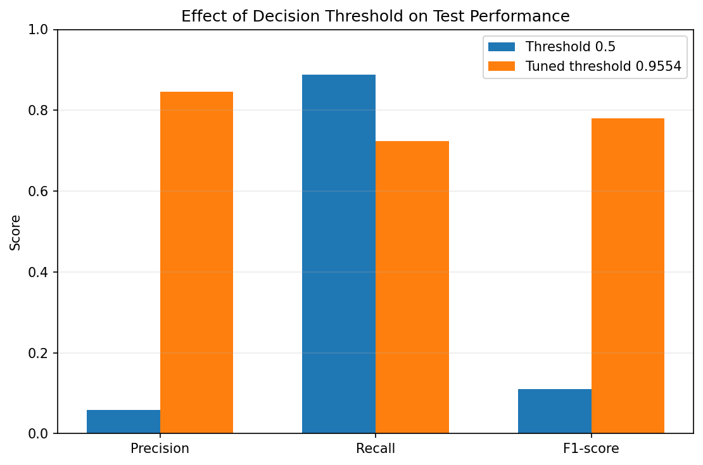

# Explainable Credit Card Fraud Detection Using a Deep Learning Ensemble

A research-inspired implementation of an explainable credit card fraud detection framework combining **CNN, RNN, LSTM, and GNN models** with weighted aggregation, confidence-aware selection, an MLP meta-learner, and SHAP-based explanations.

This project explores deep learning ensembles and explainable AI for detecting fraudulent transactions in highly imbalanced financial datasets.

## Project Overview

Credit card fraud detection is a challenging binary classification problem because fraudulent transactions represent only a small fraction of all transactions. Models must identify suspicious transactions while minimizing false alarms on legitimate transactions.

This project implements a research-inspired ensemble framework that combines multiple neural network architectures and a confidence-aware prediction mechanism. SHAP is used to investigate the features influencing model predictions.

### Key Features

- CNN, RNN, LSTM, and GNN model architectures.
- DOWA-inspired and IOWA-inspired weighted aggregation.
- Confidence-aware selection between model branches.
- MLP-based meta-learning for final predictions.
- Class-imbalance handling using weighted loss.
- Validation-based decision threshold tuning.
- Evaluation using precision, recall, F1-score, ROC-AUC, and PR-AUC.
- SHAP-based feature importance analysis.
- Visualizations for model comparison and threshold evaluation.

## Tech Stack

- **Language:** Python
- **Deep Learning:** PyTorch
- **Data Processing:** Pandas, NumPy
- **Machine Learning:** Scikit-learn
- **Explainable AI:** SHAP
- **Visualization:** Matplotlib, Seaborn
- **Environment:** Google Colab / Jupyter Notebook

## Dataset

This project uses the [Credit Card Fraud Detection dataset on Kaggle](https://www.kaggle.com/datasets/mlg-ulb/creditcardfraud).

The dataset contains 284,807 transactions, including 492 fraudulent transactions.

The dataset includes anonymized transaction features (`V1`–`V28`), transaction time, transaction amount, and a target column named `Class`.

- `Class = 0`: Legitimate transaction
- `Class = 1`: Fraudulent transaction

### Dataset Setup

The dataset is not included in this repository.

To run the notebook:

1. Download `creditcard.csv` from Kaggle.
2. Open `fraud_detection_ensemble.ipynb` in Google Colab.
3. Run the dataset upload cell.
4. Upload the downloaded CSV file when prompted.
5. Execute the notebook cells in order.

This keeps the repository lightweight and avoids redistributing the dataset.

## Methodology

### 1. Data Preprocessing

- Load and inspect the dataset using Pandas.
- Select the features used by the implementation.
- Split the data into training, validation, and test sets.
- Fit preprocessing transformations on training data to prevent data leakage.
- Handle class imbalance using a weighted loss function.

### 2. Feature Selection

The implementation uses the following ten features based on the feature ranking discussed in the reference paper:

`V14`, `V10`, `V4`, `V17`, `V12`, `V11`, `V16`, `V8`, `V3`, `V1`

### 3. Deep Learning Models

| Model | Role |
|---|---|
| CNN | Learns local patterns in transaction feature representations. |
| RNN | Learns sequential-style patterns in the input representation. |
| LSTM | Models dependencies using gated recurrent units. |
| GNN | Learns representations from a graph constructed in feature space. |

### 4. Weighted Aggregation

Two aggregation mechanisms are implemented:

- **DOWA-inspired aggregation:** Combines predictions using an ordered weighted aggregation approach.
- **IOWA-inspired aggregation:** Uses importance-weighted aggregation to combine model outputs.

These mechanisms combine predictions from different model branches.

### 5. Confidence-Aware Selection

A confidence-based mechanism estimates prediction confidence and selects between aggregated branch outputs.

The selected output and additional branch predictions are passed to the meta-learner.

### 6. Meta-Learner

A multilayer perceptron (MLP) combines outputs from the model branches to generate the final fraud probability.

### 7. Decision Threshold Tuning

The default classification threshold of 0.5 may produce too many false positives in an imbalanced dataset.

This implementation selects a decision threshold using the validation precision–recall curve to optimize F1-score. Threshold tuning changes the precision–recall trade-off without changing ROC-AUC or PR-AUC when the underlying prediction scores remain unchanged.

### 8. Explainability with SHAP

SHAP is used to investigate feature contributions to model predictions. Feature-importance visualizations help interpret which inputs influence the trained model's fraud predictions.

These explanations describe model behavior and should not be interpreted as evidence of causation.

## Results

The following metrics were obtained from the implementation's evaluation outputs.

### Model Comparison

Metrics at the default classification threshold of 0.5:

| Model | Accuracy | Precision | Recall | F1-score | ROC-AUC | PR-AUC |
|---|---:|---:|---:|---:|---:|---:|
| CNN | 0.9540 | 0.0333 | 0.9184 | 0.0642 | 0.9796 | 0.7073 |
| RNN | 0.9682 | 0.0466 | 0.8980 | 0.0886 | 0.9771 | 0.5740 |
| LSTM | 0.9721 | 0.0523 | 0.8878 | 0.0988 | 0.9617 | 0.7033 |
| GNN | 0.9712 | 0.0506 | 0.8878 | 0.0958 | 0.9659 | 0.5235 |
| Ensemble | 0.9755 | 0.0591 | 0.8878 | 0.1108 | 0.9731 | 0.6339 |

Accuracy alone is not sufficient for evaluating fraud detection because legitimate transactions dominate the dataset. Precision, recall, F1-score, and PR-AUC provide additional insight into minority-class performance.

### Model Comparison Visualization


### Effect of Threshold Tuning

| Metric | Threshold = 0.5 | Validation-tuned threshold ≈ 0.9554 |
|---|---:|---:|
| Precision | 0.0591 | 0.8452 |
| Recall | 0.8878 | 0.7245 |
| F1-score | 0.1108 | 0.7802 |
| False positives | 1,386 | 13 |

At the validation-selected threshold, the model identified 71 of the 98 fraudulent transactions in the test set and produced 13 false positives.

The higher threshold substantially improved precision and F1-score but reduced recall, meaning more fraudulent transactions were missed. The appropriate threshold depends on the relative costs of false positives and missed fraud.

### Threshold Comparison Visualization



### Confusion Matrix

The confusion matrix illustrates the distinction between correctly identified fraud, missed fraud, correctly classified legitimate transactions, and false alarms.


### SHAP Feature Importance

The SHAP visualization helps interpret the influence of input features on the model's predictions.


**Interpretation:** The ensemble provides a useful demonstration of combining multiple architectures and tuning a classification threshold for an imbalanced problem. These results apply to the evaluated dataset split and should not be assumed to generalize directly to future transactions.

## How to Run

### Option 1: Google Colab

1. Open `fraud_detection_ensemble.ipynb` in this repository.
2. Open the notebook in Google Colab.
3. Download `creditcard.csv` from Kaggle.
4. Run the dataset upload cell and select the CSV file.
5. Execute the notebook cells in order.
6. Review the model metrics, visualizations, threshold analysis, and SHAP explanations.

### Option 2: Local Environment

Clone the repository:

```bash
git clone https://github.com/harshj0207/explainable-fraud-detection.git
cd explainable-fraud-detection
```

Create and activate a virtual environment:

```bash
python -m venv .venv
```

On Windows:

```bash
.venv\Scripts\activate
```

On macOS or Linux:

```bash
source .venv/bin/activate
```

Install dependencies:

```bash
pip install -r requirements.txt
```

Launch Jupyter Notebook:

```bash
jupyter notebook
```

Open `fraud_detection_ensemble.ipynb`, download the dataset from Kaggle, and follow the notebook's data-loading instructions.

**Note:** PyTorch and PyTorch Geometric may require environment-specific installation steps. Google Colab is the recommended starting environment for this implementation.

## Repository Structure

```text
explainable-fraud-detection/
│
├── fraud_detection_ensemble.ipynb
├── README.md
├── requirements.txt
└── results/
    ├── confusion_matrix.png
    ├── model_comparison.png
    ├── shap_feature_importance.png
    └── threshold_comparison.png
```

The dataset is intentionally excluded from the repository.

## Limitations

- This is a research-inspired implementation, not a verified exact reproduction of every detail in the reference paper.
- The GNN uses a nearest-neighbor graph constructed in feature space rather than a real-world transaction network.
- The aggregation mechanisms may simplify the formulations and training objectives described in the paper.
- The meta-learner's training procedure should be reviewed for stacking leakage. Out-of-fold predictions would provide a more rigorous stacking evaluation.
- Performance depends on the data split, preprocessing, random seeds, model settings, and classification threshold.
- SHAP explanations describe model behavior and do not establish causal relationships.
- This project is intended for educational and portfolio purposes, not as a production-ready fraud detection system.

## Future Improvements

- Train the meta-learner using out-of-fold predictions.
- Explore alternative graph construction strategies.
- Compare additional class-imbalance and threshold-selection techniques.
- Evaluate calibration and stability across multiple splits.
- Test using temporally separated transactions.
- Package preprocessing and inference into a reusable pipeline.

## Reference Paper

**Explainable AI for Fraud Detection: An Attention-Based Ensemble of CNNs, GNNs, and A Confidence-Driven Gating Mechanism**

Mehdi Hosseini Chagahi et al.

arXiv preprint, version 2 dated February 22, 2025.

Paper: https://arxiv.org/abs/2410.09069

This repository contains an independent, research-inspired implementation of the paper's broad ideas. Implementation details and results may differ from those reported by the authors.

## Author

**Harsh Jain**

GitHub: https://github.com/harshj0207

---

If you find this project useful, feel free to explore the notebook and its implementation details.
